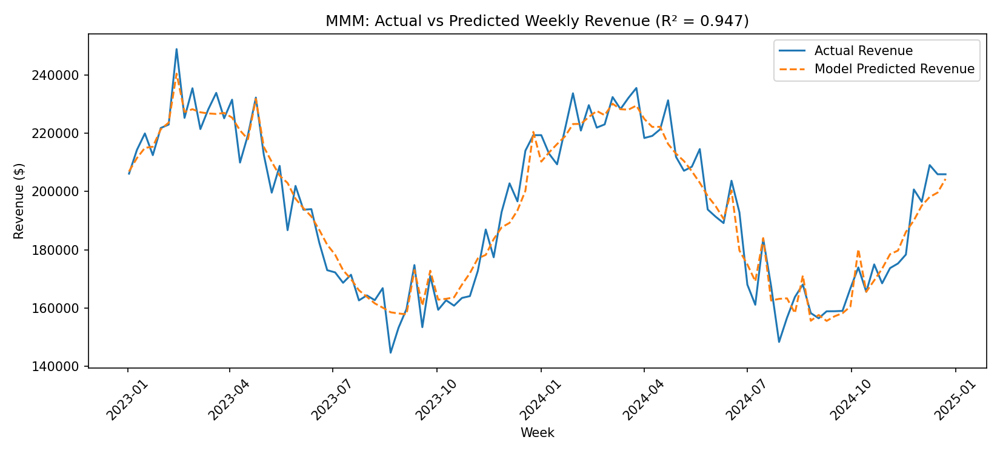
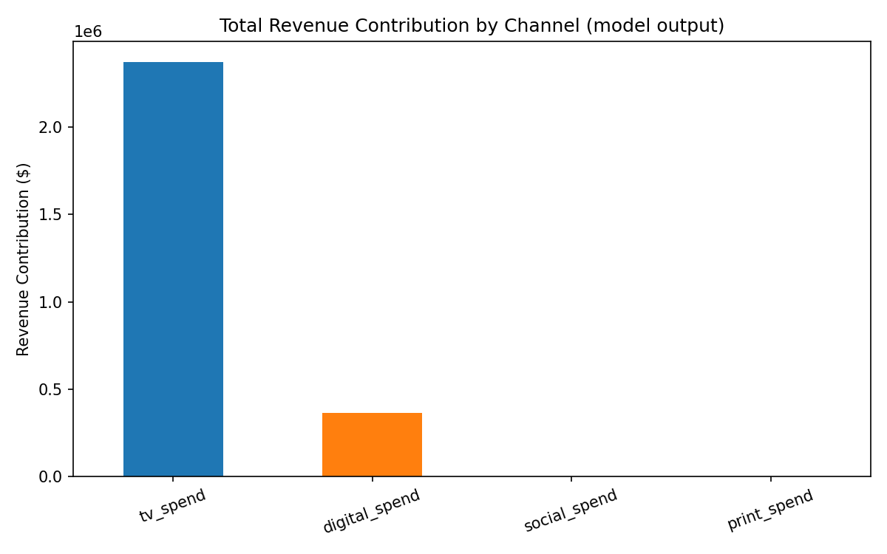

# Marketing Mix Modeling & Investment Optimization (Python)

A from-scratch Marketing Mix Model (MMM) that estimates how much weekly revenue each marketing channel drives, then uses the fitted model to evaluate a budget reallocation scenario.

**Pipeline:** Spend → Adstock → Saturation → Ridge Regression → Contribution → ROI → Budget Scenario

> **Note:** The model is built on **104 weeks of synthetic data**, so results demonstrate the methodology and are not validated against real business outcomes.

---

## Highlights

- Adstock (carryover) and saturation (diminishing returns) transformations built from scratch
- Multicollinearity check (VIF) and Ridge regression with a non-negative coefficient constraint
- Per-channel revenue contribution, ROI, and marginal ROI
- Budget reallocation scenario with total budget held constant
- SQL analysis with window functions (`AVG() OVER`, `LAG() OVER`) in SQLite
- No black-box MMM libraries, so every transformation is visible and explainable

---

## Dataset

104 weeks (2 years) of synthetic weekly data:

| Column | Description |
|---|---|
| TV, Digital, Social, Print | Weekly marketing spend per channel |
| Promotion | Promotion-week flag |
| Seasonality | Seasonality index |
| Revenue | Resulting weekly revenue |

Known adstock decay and saturation effects are injected during data generation (`generate_mmm_data.py`), so the pipeline's output can be checked against a known pattern.

---

## Project Structure

```
.
├── generate_mmm_data.py          # Generates the synthetic weekly dataset
├── weekly_marketing_data.csv     # Generated dataset
├── sql_analysis.py               # SQLite aggregation + window-function queries
├── mmm_pipeline.py               # Full modeling pipeline
├── channel_contribution_roi.csv  # Contribution and ROI results
├── actual_vs_predicted.png       # Model fit chart
├── channel_contribution.png      # Channel contribution chart
└── README.md
```

---

## Pipeline

0. **SQL analysis (`sql_analysis.py`)**: loads the data into SQLite and runs the aggregation queries that usually precede modeling: channel-wise total spend, monthly revenue trend, 4-week moving average and week-over-week growth (window functions), and promotion-week vs regular-week revenue.
1. **Cleaning**: imputes missing spend values using a rolling median.
2. **EDA**: summary statistics and correlation matrix.
3. **Adstock**: geometric carryover transform, with the decay rate per channel chosen by grid search against correlation with revenue.
4. **Saturation**: power-curve diminishing-returns transform (α = 0.6, a documented fixed assumption).
5. **Collinearity check (VIF)**: computed and reported, since channels whose spend moves together are hard to separate.
6. **Regression**: Ridge regression (L2 penalty) with `positive=True`, chosen because of the collinearity found in step 5 and because spend should not have a negative effect on revenue.
7. **Contribution and ROI**: per-channel revenue contribution, estimated ROI per $1, and marginal ROI at the current spend level.
8. **Budget scenario**: shifts 10% of the lowest-marginal-ROI channel's budget to the highest-marginal-ROI channel (total budget constant) and re-runs the fitted model to estimate the revenue change.

---

## Key Results

*Results from one run; they may vary if the data is regenerated.*

| Metric | Value |
|---|---|
| R² (21-week hold-out test set) | 0.89 |
| MAPE (test set) | 2.78% |
| R² (refit on full data) | 0.947 |
| TV contribution | ~11.7% of revenue (ROI ≈ $0.51 per $1) |
| Digital contribution | ~1.8% of revenue (ROI ≈ $0.11 per $1) |
| Budget scenario (10% of Social budget → TV) | +0.27% estimated revenue change |





### Interpretation

- **TV is the strongest driver** among the channels with a non-zero effect.
- **Social and Print received a zero coefficient.** With only 104 weeks of data and small, low-variance spend on these channels, the model could not statistically separate their effect from zero once TV and seasonality were accounted for. More data, deliberate spend variation (geo or holdout tests), or Bayesian priors would help.
- **The budget scenario result is small** and is a model-based estimate, not a guaranteed real-world outcome.

---

## How to Run

```bash
pip install pandas numpy matplotlib scikit-learn
python generate_mmm_data.py
python sql_analysis.py
python mmm_pipeline.py
```

---

## Tech Stack

Python, Pandas, NumPy, scikit-learn (Ridge regression), Matplotlib, SQL (SQLite, window functions `LAG` and `AVG OVER`)

---

## Limitations & Future Work

**Limitations**
- Synthetic data, not validated against real business outcomes
- The saturation curve shape (α) is a fixed assumption, not fit from data
- Adstock decay is chosen by simple grid search, not formally optimized
- VIF shows meaningful collinearity for TV and seasonality, which limits how confidently individual effects can be separated

**Future work**
- Add unit tests (PyTest) for the adstock and saturation functions
- Refactor the pipeline into reusable functions or classes
- Fit the saturation parameter from data
- Try Bayesian priors or real marketing data
